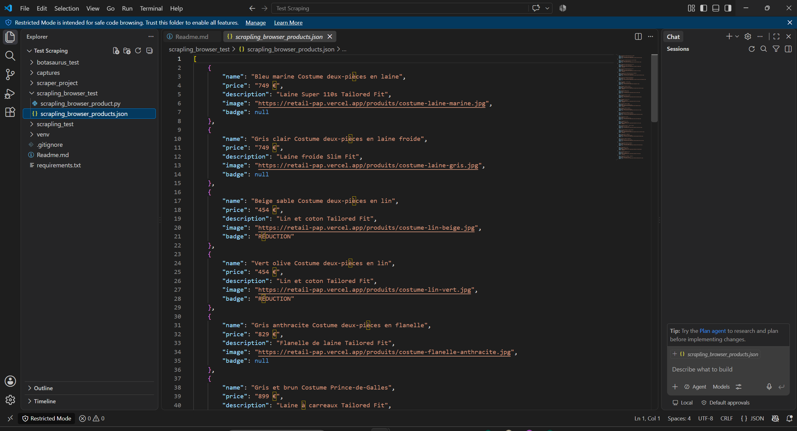
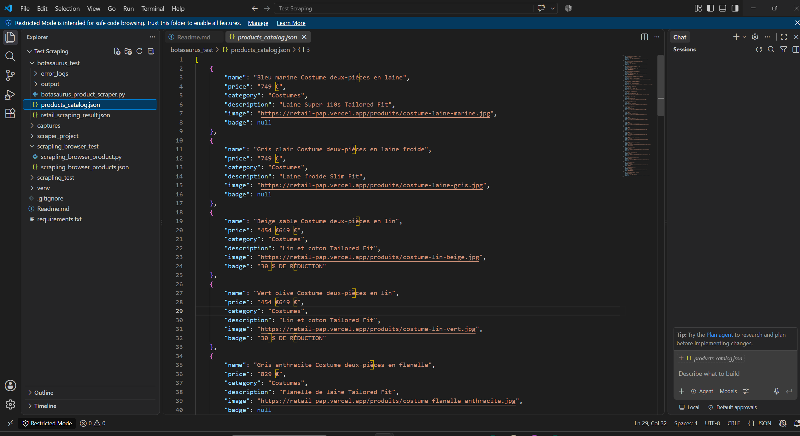

# Compte rendu de benchmark — Comparaison des solutions de Web Scraping

## 1. Objectif du benchmark

[Classement des meilleurs outils de Web Scraping en Python](https://github.com/topics/web-scraping-python)

L'objectif de ce test est de comparer plusieurs solutions modernes de Web Scraping afin d'identifier l'approche la plus adaptée selon le type de site rencontré.

Les solutions étudiées sont :

- **Scrapy** : framework historique orienté crawling et extraction massive.
- **Botasaurus** : framework orienté navigateur automatisé avec capacités anti-détection.
- **Scrapling** : framework récent combinant scraping classique, navigateur dynamique et extraction adaptative.

Le site utilisé pour les tests est :

```
https://retail-pap.vercel.app/
```

Il s'agit d'un site e-commerce moderne dont les produits sont générés côté navigateur avec JavaScript.

Les informations recherchées :

- nom produit
- prix
- description
- image
- badge promotionnel

Le benchmark se prolonge par un **cas client réel** (Galeries Bartoux) : un pipeline complet en 3 étapes qui scrape un catalogue d'œuvres d'art, optimise les images et enrichit chaque œuvre avec des métadonnées visuelles (voir sections 4.5 à 4.8).

---

## 2. Installation et prérequis

Avant d'exécuter les tests, il faut créer un environnement virtuel Python et installer les dépendances.

### 2.1 Créer l'environnement virtuel

```bash
python -m venv venv
```

### 2.2 Activer l'environnement virtuel

Sur Windows (PowerShell) :

```powershell
venv\Scripts\Activate.ps1
```

Sur macOS / Linux (serveur inclus) :

```bash
source venv/bin/activate
```

> Sur Linux, le script d'activation est dans `venv/bin/`, pas à la racine du venv.

### 2.3 Installer les dépendances

```bash
pip install -r requirements.txt
```

Le fichier `requirements.txt` a été généré avec la commande suivante et regroupe toutes les dépendances nécessaires aux trois frameworks testés (Scrapy, Botasaurus, Scrapling) :

```bash
pip freeze > requirements.txt
```

### 2.4 Dépendances supplémentaires du pipeline Bartoux (étapes 2 et 3)

```bash
pip install "Pillow>=10.0" anthropic python-dotenv
```

| Paquet | Rôle |
|---|---|
| Pillow | conversion WebP (libwebp intégré) et extraction des couleurs |
| anthropic | appel au modèle de vision (étape 3) |
| python-dotenv | lecture du fichier `.env` |

---

## 3. Présentation des solutions testées

### 3.1 Scrapy

#### Description

Scrapy est un framework Python mature spécialisé dans :

- crawling massif
- exploration de plusieurs pages
- extraction structurée
- pipelines de données

Architecture :

```
Spider
 |
 v
Requête HTTP
 |
 v
HTML serveur
 |
 v
Extraction XPath/CSS
 |
 v
Pipeline
```

#### Avantages

- Très rapide
- Faible consommation mémoire
- Excellent pour les gros volumes
- Très utilisé en production

#### Limites

- N'exécute pas JavaScript par défaut
- Difficulté avec les applications React/Vue/Next.js
- Nécessite Selenium/Playwright pour les pages dynamiques

#### Exécution du test

```bash
cd scraper_project/scraper_project
scrapy crawl retail -o retail_result.json
```

---

### 3.2 Botasaurus

#### Description

Botasaurus est un framework orienté navigateur réel. Il utilise :

- Chromium
- automatisation navigateur
- gestion des sessions
- mécanismes anti-détection

Architecture :

```
Navigateur Chromium
        |
        v
JavaScript exécuté
        |
        v
Page complète
        |
        v
Extraction
```

#### Résultat du test

Sur le site `https://retail-pap.vercel.app/` :

- Page chargée
- Produits détectés
- 24 produits extraits
- Images récupérées
- Prix récupérés

Exemple :

```json
{
  "name": "Bleu marine Costume deux-pièces en laine",
  "price": "749 €",
  "description": "Laine Super 110s Tailored Fit",
  "image": "...jpg"
}
```

#### Avantages

- Très efficace sur les sites modernes
- Gestion JavaScript native
- Bon comportement face aux protections
- Extraction proche d'un utilisateur réel

#### Limites

- Plus lourd qu'un scraper HTTP classique
- Consomme plus de ressources

#### Exécution du test

```bash
cd botasaurus_test
python botasaurus_product_scraper.py
```

---

### 3.3 Scrapling

#### Description

Scrapling est un framework récent proposant plusieurs niveaux de scraping :

- scraping HTTP classique
- navigateur dynamique
- navigateur furtif

Il permet d'adapter la stratégie selon la difficulté du site.

Architecture générale :

```
Scrapling
    |
    +-- Fetcher
    |
    +-- DynamicFetcher
    |
    +-- StealthyFetcher
```

---

## 4. Tests détaillés Scrapling

### 4.1 Scrapling Fetcher

#### Résultat

```
Page récupérée
Titre trouvé
Produits non détectés
```

Cause : les produits sont injectés après exécution JavaScript.

Conclusion : non adapté pour ce site.

#### Exécution du test

```bash
cd scrapling_test
python scrapling_test.py
```

---

### 4.2 Scrapling DynamicFetcher

#### Fonctionnement

Utilisation d'un navigateur Chromium.

#### Résultat

```
Nombre produits trouvés : 24
```

Données extraites :

- Nom
- Prix
- Image
- Description

Conclusion : excellent compromis pour les sites modernes.

---

### 4.3 Scrapling StealthyFetcher

#### Fonctionnement

Même principe que DynamicFetcher mais avec une couche furtive.

#### Résultat

```
Nombre produits trouvés : 24
```

Données extraites :

- Nom
- Prix
- Image
- Description

Conclusion : plus adapté aux sites protégés.

#### Exécution du test

```bash
cd scrapling_browser_test
python scrapling_browser_product.py
```

---

### 4.4 Scrapling DynamicFetcher — version robuste (catalogue avec suivi)

#### Fonctionnement

Version consolidée du test DynamicFetcher, ajoutant un suivi du catalogue entre les exécutions :

- détection des nouveaux produits
- détection des produits orphelins (disparus du site)
- détection des produits modifiés entre deux passages
- journalisation complète dans un fichier de log
- écriture du catalogue dans un fichier `catalogue.json`

#### Résultat

```
Nombre articles trouvés (bruts) : 24
Produits valides extraits : 24

===== RÉSUMÉ =====
Total catalogue : 24
Actifs          : 24
Orphelins       : 0
Modifiés (ce run) : 0
Fichier          : catalogue.json
```

Conclusion : version prête pour un usage répété (suivi de catalogue dans le temps), adaptée à une intégration dans un pipeline de veille produit.

#### Exécution du test

```bash
cd Scrapling_DynamicFetcher
python scrap_catalogue.py
```

Fichiers générés :

- `catalogue.json` : catalogue consolidé des produits
- `scraping.log` : journal détaillé de l'exécution

---

### 4.5 Cas d'usage réel : Galeries Bartoux — vue d'ensemble du pipeline

Au-delà du site de test `retail-pap.vercel.app`, la version robuste a été mise en œuvre sur un cas réel : le site `galeries-bartoux.com`, qui référence des œuvres d'art classées par artiste (peintres, sculpteurs, design).

Le traitement est découpé en **3 scripts indépendants et chaînables**, dans le dossier `Scrapling_demos_clients/` :

```
ÉTAPE 1  scrapling_bartoux.py     Scraping (Scrapling StealthyFetcher)
   |  produit : artistes.json, catalogue.json, artistes/<slug>/*.jpg
   v
ÉTAPE 2  enrich_bartoux.py        JPEG -> WebP + extraction des couleurs
   |  produit : output_final/ (images WebP, catalogue.json, artistes.json)
   v
ÉTAPE 3  enrich_ai_bartoux.py     Modèle de vision : subjects, style, mood, description
      met à jour : output_final/catalogue.json
```

Principe clé : **les fichiers produits par l'étape 1 ne sont jamais modifiés par les étapes 2 et 3.** Les données finales à utiliser en production sont celles du dossier `output_final/`.

| Script | Entrée | Sortie | Clé API |
|---|---|---|---|
| `scrapling_bartoux.py` | site web | `artistes.json`, `catalogue.json`, `artistes/` | non |
| `enrich_bartoux.py` | sorties de l'étape 1 | `output_final/` | non |
| `enrich_ai_bartoux.py` | `output_final/` | `output_final/catalogue.json` enrichi | **oui** (`.env`) |

---

### 4.6 Étape 1 — `scrapling_bartoux.py` (scraping)

#### Fonctionnement

- Charge la page des artistes, extrait la liste par catégorie (Peintre, Sculpteur, Design).
- Visite chaque page artiste : récupère la **biographie** (5 méthodes en cascade : sélecteurs CSS, XPath, texte brut, meta description, JSON-LD) et les liens des œuvres.
- Visite chaque page œuvre : titre, dimensions, image, téléchargement de l'image dans `artistes/<slug-artiste>/`.
- Détection de changements par hash (NOUVEAU / CHANGÉ / ORPHELIN), hash conservé dans un fichier interne séparé.
- Une bio déjà connue n'est jamais écrasée par une bio vide.

#### Robustesse

- Timeout de 120 s au premier essai, +30 s à chaque nouvel essai.
- 5 essais par page avec backoff exponentiel.
- Seconde passe automatique (6 essais, 180 s) sur tout ce qui a échoué.
- Garde-fou : si le scraping retourne trop peu de résultats (< 35 % de l'existant), les JSON ne sont pas modifiés.
- `FRESH_START = True` : repart de zéro à chaque exécution (anciens fichiers sauvegardés dans `backups/`).
- Pour tester rapidement, mettre `MAX_ARTISTS = 5` dans la configuration du script.

#### Structure générée

```
Scrapling_demos_clients/
│
├── scrapling_bartoux.py          ← étape 1
├── enrich_bartoux.py             ← étape 2
├── enrich_ai_bartoux.py          ← étape 3
├── .env                          ← clé API (NON versionné)
├── .env.example                  ← modèle de configuration
│
├── artistes.json                 ← liste des artistes (sortie étape 1)
├── catalogue.json                ← liste des œuvres (sortie étape 1)
├── hashes_internes.json          ← hash de détection de changement (interne)
├── scraping_bartoux.log          ← journal de l'étape 1
├── backups/                      ← sauvegardes horodatées
│
├── artistes/                     ← images originales (JPEG)
│   ├── al-freno/
│   │   ├── a-whiter-shade-of-pale-150x150cm.jpg
│   │   └── ...
│   ├── chris-carolina/
│   └── ...
│
└── output_final/                 ← sorties des étapes 2 et 3 (à utiliser)
    ├── catalogue.json
    ├── artistes.json
    ├── images/<slug-artiste>/*.webp
    ├── rapport_traitement.json
    ├── rapport_ai.json
    ├── enrich_bartoux.log
    ├── enrich_ai_bartoux.log
    └── backups/
```

#### Structure de `artistes.json`

```json
{
  "a1b2c3d4e5f6g7h8": {
    "id": "a1b2c3d4e5f6g7h8",
    "name": "AL FRENO",
    "url": "https://www.galeries-bartoux.com/artistes/al-freno/",
    "bio": "Biographie de l'artiste...",
    "type": "Peintre"
  }
}
```

#### Structure de `catalogue.json` (sortie étape 1)

```json
{
  "9f8e7d6c5b4a3210": {
    "artist_id": "a1b2c3d4e5f6g7h8",
    "artist_name": "AL FRENO",
    "artist_slug": "al-freno",
    "artist_category": "Peintre",
    "title": "A WHITER SHADE OF PALE",
    "dimensions": "150 x 150 cm",
    "image": "https://www.galeries-bartoux.com/wp-content/uploads/....jpg",
    "local_image": "artistes/al-freno/a-whiter-shade-of-pale-150x150cm.jpg",
    "url": "https://www.galeries-bartoux.com/artistes/al-freno/..."
  }
}
```

#### Exécution

```bash
python scrapling_bartoux.py
```

---

### 4.7 Étape 2 — `enrich_bartoux.py` (WebP + couleurs)

#### Fonctionnement

Pour chaque œuvre du catalogue :

1. Ouverture de l'image **originale** (une seule fois, en mémoire, orientation EXIF corrigée).
2. **Extraction des couleurs dominantes** sur l'original (avant toute conversion, donc sans aucune perte) : quantification Pillow (median cut) sur une version réduite, puis fusion des teintes proches. Chaque couleur est donnée en hex, RGB, nom français et pourcentage.
3. **Conversion en WebP**, en conservant le profil ICC.
4. Ajout de la structure `ai_metadata` dans le catalogue (`colors` rempli, les 4 autres champs vides).

#### Choix du mode WebP

| Mode | Réglage | Comportement |
|---|---|---|
| `lossy` (par défaut) | qualité 92, méthode 6 | visuellement identique, nettement plus léger |
| `lossless` | `WEBP_MODE=lossless` | pixel-perfect, mais souvent **plus lourd** que le JPEG d'origine (un JPEG est déjà compressé avec perte) |

#### Résultat du test (5 œuvres)

```
Converties : 5 | échecs : 0
Poids : 2.0 Mo -> 1.5 Mo (+28.2 % de gain)
```

#### Robustesse

- Traitement parallèle (processus multiples).
- Relecture avec backoff si un fichier est verrouillé ou illisible (3 essais).
- Une image en échec n'arrête pas le lot.
- Écritures atomiques, reprise automatique (ce qui est déjà fait est sauté).
- Les champs IA déjà remplis ne sont jamais écrasés.
- Sources jamais modifiées ; tout est écrit dans `output_final/`.

#### Options

```bash
python enrich_bartoux.py --limit 10     # test sur 10 œuvres
python enrich_bartoux.py --force        # retraite tout
python enrich_bartoux.py --workers 4    # nombre de processus
```

> Attention : avec `--limit N`, le `output_final/catalogue.json` ne contient que N œuvres. Un lancement complet sans `--limit` le reconstruit en entier.

---

### 4.8 Étape 3 — `enrich_ai_bartoux.py` (modèle de vision)

#### Fonctionnement

Envoie chaque image WebP à un modèle de vision Claude, avec en contexte : titre, catégorie, dimensions, couleurs mesurées et biographie de l'artiste. Remplit les champs encore vides :

| Champ | Contenu |
|---|---|
| `subjects` | 3 à 8 éléments concrets visibles |
| `style` | 1 à 3 styles (abstrait, pop art, minimaliste...) |
| `mood` | 1 à 3 ambiances (calme, énergique, mélancolique...) |
| `visual_description` | 1 à 2 phrases factuelles |

La sortie du modèle est contrainte par un schéma (tool use forcé), puis revalidée et normalisée localement.

#### Configuration (`.env`)

```
ANTHROPIC_API_KEY=ta_cle
# optionnel
ANTHROPIC_MODEL=claude-opus-5-5
```

Modèle par défaut : `claude-opus-5-5` (meilleure vision). Alternative plus économique : `claude-sonnet-5-5`.

#### Robustesse

- Retries avec backoff exponentiel sur erreurs réseau, 429, 5xx et timeout (5 essais, timeout croissant).
- Seconde passe automatique sur les échecs (6 essais, 180 s).
- Clé invalide ou modèle inconnu : arrêt propre du lot.
- Sauvegarde atomique toutes les 15 œuvres et à l'interruption (Ctrl+C).
- Backup du catalogue avant la première écriture.
- Ne remplace jamais un champ déjà rempli (sauf `--force`).

#### Options

```bash
python enrich_ai_bartoux.py --limit 5
python enrich_ai_bartoux.py --force
python enrich_ai_bartoux.py --model claude-sonnet-5-5 --workers 4
```

#### Structure finale de `output_final/catalogue.json`

```json
{
  "9f8e7d6c5b4a3210": {
    "artist_id": "a1b2c3d4e5f6g7h8",
    "artist_name": "AL FRENO",
    "artist_slug": "al-freno",
    "artist_category": "Peintre",
    "title": "A WHITER SHADE OF PALE",
    "dimensions": "150 x 150 cm",
    "image": "https://www.galeries-bartoux.com/wp-content/uploads/....jpg",
    "local_image": "images/al-freno/a-whiter-shade-of-pale-150x150cm.webp",
    "url": "https://www.galeries-bartoux.com/artistes/al-freno/...",
    "ai_metadata": {
      "colors": [
        { "hex": "#e8e4dc", "rgb": [232, 228, 220], "name": "creme", "percent": 46.5 },
        { "hex": "#2b3a55", "rgb": [43, 58, 85], "name": "bleu marine", "percent": 21.0 }
      ],
      "subjects": ["exemple", "à remplir par le modèle"],
      "style": ["exemple"],
      "mood": ["exemple"],
      "visual_description": "Exemple de description générée par le modèle."
    }
  }
}
```

> Les valeurs de `ai_metadata` ci-dessus sont des exemples de format.

---

### 4.9 Lancer le pipeline complet sur le serveur

#### Préparation (une seule fois)

```bash
cd ~/apps/scraping-framework-benchmark
source venv/bin/activate
pip install --upgrade pip
pip install -r requirements.txt
pip install "Pillow>=10.0" anthropic python-dotenv

cd Scrapling_demos_clients
cp .env.example .env
nano .env        # ajouter ANTHROPIC_API_KEY=ta_cle
```

#### Tests rapides (avec limites)

```bash
# Étape 1 : limiter à 5 artistes (MAX_ARTISTS n'a pas d'option en ligne de commande)
sed -i 's/^MAX_ARTISTS = None/MAX_ARTISTS = 5/' scrapling_bartoux.py
python scrapling_bartoux.py

# Étape 2 : 10 œuvres
python enrich_bartoux.py --limit 10

# Étape 3 : 5 œuvres
python enrich_ai_bartoux.py --limit 5

# Remettre la limite à "aucune" avant le vrai lancement
sed -i 's/^MAX_ARTISTS = 5/MAX_ARTISTS = None/' scrapling_bartoux.py
```

#### Lancement complet en arrière-plan (nohup)

Les 3 étapes à la suite : si une étape échoue, la suivante n'est pas lancée.

```bash
nohup sh -c 'python -u scrapling_bartoux.py && python -u enrich_bartoux.py && python -u enrich_ai_bartoux.py' > pipeline.out 2>&1 &
```

Ou étape par étape :

```bash
nohup python -u scrapling_bartoux.py > etape1.out 2>&1 &
nohup python -u enrich_bartoux.py > etape2.out 2>&1 &
nohup python -u enrich_ai_bartoux.py > etape3.out 2>&1 &
```

Le processus continue même si la connexion SSH ou le terminal est fermé. (Alternative : `tmux`.)

#### Suivre les logs en direct

```bash
tail -f pipeline.out                              # sortie globale
tail -f scraping_bartoux.log                      # étape 1
tail -f output_final/enrich_bartoux.log           # étape 2
tail -f output_final/enrich_ai_bartoux.log        # étape 3
tail -n 50 pipeline.out                           # dernières lignes
grep -E "WARNING|ERROR" pipeline.out | tail -n 30   # problèmes uniquement
```

`Ctrl+C` quitte le `tail` sans arrêter le traitement.

#### Vérifier / arrêter le traitement

```bash
pgrep -af "scrapling_bartoux|enrich_bartoux|enrich_ai_bartoux"   # est-ce en cours ?
pkill -f enrich_ai_bartoux.py                                    # arrêter (la reprise reste possible)
```

#### Vérifier les résultats

```bash
cat output_final/rapport_traitement.json | head -n 30
cat output_final/rapport_ai.json | head -n 30
du -sh artistes output_final/images       # poids avant / après WebP
```

#### Reprise après interruption

Relancer simplement la même commande : les étapes 2 et 3 sautent ce qui est déjà fait.

#### Bonnes pratiques Git

Le `.gitignore` doit contenir :

```
.env
venv/
artistes/
output_final/
backups/
*.log
*.out
hashes_internes.json
```

Ne jamais versionner `.env` (clé API).

---

## 5. Tableau comparatif global

| Critère                     | Scrapy       | Botasaurus             | Scrapling                   |
|------------------------------|--------------|-------------------------|-------------------------------|
| Type                         | HTTP crawler | Navigateur automatisé   | Framework hybride             |
| JavaScript                   | Non natif    | Oui                      | Oui, avec Dynamic/Stealth     |
| Rapidité                     | ⭐⭐⭐⭐⭐        | ⭐⭐⭐                     | ⭐⭐⭐⭐                          |
| Consommation ressources      | Faible       | Élevée                   | Moyenne                       |
| Sites React/Vue/Next         | Limité       | Excellent                | Excellent                     |
| Anti-bot                     | Faible       | Très bon                 | Très bon avec Stealthy        |
| Crawling massif               | Excellent    | Moyen                    | Bon                            |
| Facilité extraction produit  | Moyenne      | Excellente               | Excellente                    |
| Production e-commerce        | Très bon     | Très bon                 | Très bon                      |

---

## 6. Résultats du benchmark sur le site testé

| Solution                  | Résultat                                              |
|----------------------------|--------------------------------------------------------|
| Scrapy                     | HTML récupéré mais nécessite rendu JS supplémentaire  |
| Botasaurus                 | 24 produits extraits avec succès                       |
| Scrapling Fetcher          | Page récupérée mais produits absents                   |
| Scrapling DynamicFetcher   | 24 produits extraits avec succès                       |
| Scrapling StealthyFetcher  | 24 produits extraits avec succès                       |

---

## 7. Conclusion générale

Les tests montrent qu'il n'existe pas un outil universel : le choix dépend du type de site.

### Sites simples et gros volumes

→ **Scrapy**

Meilleur choix pour :

- crawling massif
- catalogues importants
- extraction rapide

### Sites modernes avec JavaScript

→ **Botasaurus ou Scrapling DynamicFetcher**

Meilleur choix pour :

- e-commerce
- React
- Next.js
- pages dynamiques

### Sites protégés

→ **Scrapling StealthyFetcher ou Botasaurus**

Meilleur choix pour :

- Cloudflare
- anti-bot
- fingerprint navigateur

### Conclusion du test réalisé

Sur le site `retail-pap.vercel.app` :

- Scrapy nécessite une couche navigateur supplémentaire.
- Botasaurus récupère directement les produits avec succès.
- Scrapling DynamicFetcher récupère également les produits avec une approche plus légère.
- Scrapling StealthyFetcher apporte une couche supplémentaire pour les sites protégés.

Sur le cas réel `galeries-bartoux.com`, le pipeline en 3 étapes (`scrapling_bartoux.py`, `enrich_bartoux.py`, `enrich_ai_bartoux.py`) transforme un site vitrine en un jeu de données exploitable : artistes avec biographie, œuvres avec images WebP allégées (environ 28 % de gain sur l'échantillon testé), palette de couleurs mesurée et métadonnées visuelles générées par un modèle de vision. Chaque étape est robuste (retries, timeouts croissants, seconde passe, reprise, sauvegardes) et indépendante, ce qui confirme la pertinence de Scrapling pour un déploiement chez un client.

Le meilleur compromis observé pour un projet e-commerce moderne est :

**Scrapling DynamicFetcher / Botasaurus selon le niveau de protection du site.**

<p align="center">
  
  
</p>